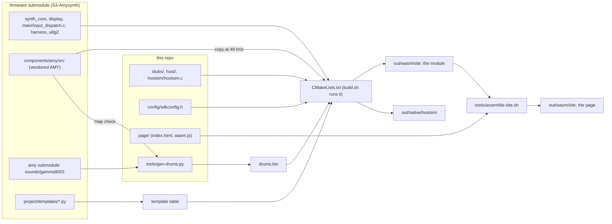

# amysynth-wasm

Builds the [S3-Amysynth](https://github.com/rt-rtos/S3-Amysynth) firmware's
application code and AMY engine for a host: natively, as `hostsim` (replay
logs, a step protocol over stdin), and with Emscripten as the static site at
<https://rt-rtos.github.io/amysynth-web/>.

The firmware is the `firmware` submodule, compiled as it is. This repo holds
only what the device has and a host does not: headers standing in for
ESP-IDF, FreeRTOS and the board's drivers (`stubs/`), their host
implementations (`host/`), the program that drives the firmware's boot,
input and render in place of its tasks (`hostsim/hostsim.c`), and the page.
[`SHIMS.md`](SHIMS.md) lists every one of them and what it changes. The firmware commit
the submodule pins is the one the site runs, and the page shows it.

## Building

    git clone --recurse-submodules <this repo>
    ./build.sh                     # native: out/native/hostsim
    source <emsdk>/emsdk_env.sh    # Emscripten, for the site
    ./build.sh wasm                # out/wasm/site, plus node builds of the module
    (cd out/wasm/site && python3 -m http.server)

Needs gcc, zlib, Python 3, CMake 3.28 or later, Ninja, and for the site an
Emscripten SDK (built here with emcc 6.0.11). `./build.sh san` is the
native build with ASan and UBSan; `./build.sh wasm --single` adds the site
as one HTML file that opens from disk, the lab pages opening as tabs from it
and applying to it by postMessage. Everything else (the replay log
grammar, the step protocol, what is stood in for, how the wasm build
differs): [`hostsim/README.md`](hostsim/README.md).

`FW_ROOT=<checkout> ./build.sh ...` builds against another firmware checkout,
such as a working tree with uncommitted changes. The page's version string is
`git describe --tags --always --dirty` of the firmware tree, or
`HOSTSIM_VERSION`.

The build itself is the CMake project in `CMakeLists.txt`. `build.sh`
configures it into `out/<mode>/build` (through `emcmake` for wasm) when that
directory is new or when `FW_ROOT`, `HOSTSIM_CFLAGS` or `HOSTSIM_WASM_STACK`
changed, then builds it with Ninja. Ninja rebuilds an object when its
compile command changed or when its source or any header it included is
newer; the generated inputs (the AMY copy, `drums.bin`, the template table)
are redone when one of their declared inputs is newer. Sources are found by
directory (`file(GLOB ... CONFIGURE_DEPENDS)`), so a source added to or
removed from the firmware is picked up by the next build.
`HOSTSIM_CLEAN=1 ./build.sh ...` deletes `out/<mode>/build` first. Compiler
warnings show for the objects a build compiles; an object that is not
rebuilt does not show its warnings again. In the wasm build,
`tools/assemble-site.sh` writes the page, `controls.md` and `notices.txt`
on every build, after the module links.

## What is generated, and from where

- `drums.bin`, the drum sample banks the device keeps in its `drums`
  partition: concatenated from the samples of the AMY release the firmware's
  `amy` submodule pins, and checked entry by entry against the firmware's
  `components/amy/src/pcm_gamma9001.h` (`tools/gen-drums.py`).
- AMY's 48 kHz: the firmware gets it from an `ESP_PLATFORM` branch in
  `amy.h`, which a host build does not take. The build copies AMY's sources
  and sets the generic fallback to 48000.
- The template table: the firmware's own generator,
  `components/synth_core/project/templates/gen_templates.py`.
- `config/sdkconfig.h` is not generated. It is the web build's own
  configuration, edited by hand and independent of the device's: it started
  from the device's generated header with `CONFIG_SYNTH_WIRELESS` cleared,
  and a device default can change without it. Every Kconfig symbol the
  firmware declares is either defined there or listed as
  `/* CONFIG_X is not set */`; `tools/kconfig-gate.py` lists the ones that
  are neither.

## Publishing

The site is served from the `amysynth-web` repo in two channels: its root is
the stable channel, `next/` the nightly. Its `update.sh` takes
`out/wasm/site` and a channel and commits it with the version the page
names. In the firmware repo, `nightly` is the development branch and main
the verified one; here, main pins the nightly's firmware and `stable` the
stable channel's, each with the glue its firmware builds with.

`.github/workflows/site.yml` runs every hour, one channel after the other.
For the nightly, when the firmware's `nightly` branch has moved past the
`firmware` pin, it checks out the new firmware commit and stops before
building if the firmware declares a Kconfig symbol `config/sdkconfig.h` has
no setting for (`tools/kconfig-gate.py`): the web value is decided by hand,
with a line added there. Then it builds native and wasm and runs
`tools/smoke.py --wasm`, which loads every built-in template in both builds,
requires each to play above -60 dBFS, and requires button 3 to change the
screen. Only a run that passes all of it moves the pin (a `Firmware <sha>:
<subject>` commit on main) and publishes `next/`. A failed run publishes
nothing and is not retried until the branch or the firmware has a new
commit. Either channel whose pin is current but whose page runs another
firmware is built, checked and published the same way. The workflow can
also be started by hand; `force` republishes both channels.

Promotion is by hand, after the firmware was played through on the device:
`tools/promote.sh [<firmware commit>]` (default: the head of `nightly`)
fast-forwards the firmware's main branch to it, moves `stable` here to the
`Firmware <sha>` commit that pinned it, and starts the workflow, which
rebuilds the root from that commit.

## Licence

MIT (`LICENSE`), as the firmware. The site's `notices.txt` carries the
licences of the third-party code and data compiled in.
